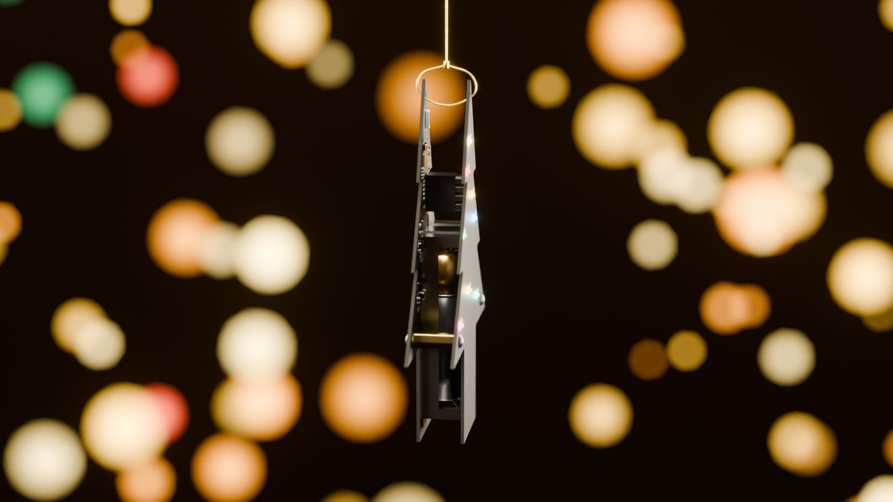
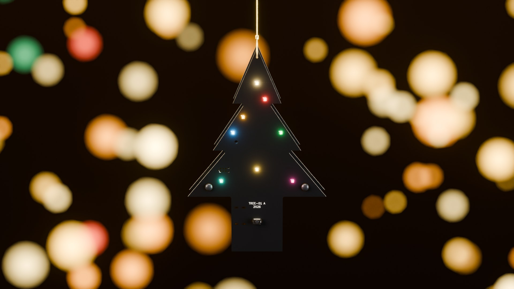

# TREE-01 — Wireless RGB Christmas Tree Ornament

  

**TREE-01** is a double-sided, battery-powered Bluetooth LE Christmas tree ornament built from two stacked 4-layer matte-black & ENIG-gold PCBs. Designed in KiCad 10 with automated geometry, DRC, EMI, and BOM/fab verification.

---

## Highlights

- **Double-Sided 16-LED RGB Matrix:** 16× tiny `1.0 × 1.0 mm` common-anode RGB LEDs (`XL-1010RGB-YG`) — 8 on the front (Board B) and 8 mirrored on the back (Board A) — charlieplexed across just 8 GPIO lines with ghost-free slot scheduling.
- **Ultra-Low-Power BLE SoC:** Nordic `nRF54L10` (QFN-48, pin-compatible with `nRF54L15`) with a `2.45 GHz` Johanson chip antenna at the copper-free tree tip for phone-based time sync, effect selection, and BLE DFU.
- **Smart Power Architecture:** `TPS63900` buck-boost regulator switches between **3.0 V** in sleep (`< 5 µA` whole-board target) and **3.5 V** while LEDs are lit, delivering **~36 days** of runtime (11 h/day schedule) on 2× AAA alkaline cells.
- **Two Power Variants, One PCB:**
  - **Variant A (default):** JLC-assembled SMT 2× AAA holder (`BH-AAA-B5AA001`) centered in the 12 mm inter-board gap.
  - **Variant B:** Rechargeable Li-ion pouch cell with `MCP73831` charger and USB-C power input.
- **Clean 12 mm Sandwich Stack:** Two 1.0 mm boards joined by a single mated 2×4 `2.54 mm` SMD header (8 LED lines) and two `12.0 mm` M2 brass hex standoffs (carrying GND to Board B) with black nylon screws.

---

## Specifications

| Parameter | Value |
|---|---|
| **Dimensions** | `70 × 105 mm` outline, `14.0 mm` board-to-board (`14.8 mm` over LEDs) |
| **PCB Stackup** | 4-layer, `1.0 mm` (`JLC04101H-7628`), matte black solder mask, ENIG gold |
| **MCU & RF** | `nRF54L10-QFAA` (BLE 2.4 GHz), Johanson `2450AT42A100E` chip antenna |
| **LEDs** | 16× `XL-1010RGB-YG` (`1 × 1 × 0.4 mm`), 48 dies charlieplexed on 8 lines |
| **Power** | `TPS63900` buck-boost (`3.0 V` idle / `3.5 V` lit), reverse-polarity P-FET (`Q1`) |
| **Battery** | Variant A: 2× AAA in series (`~36 days` @ 1.0 mA default) · Variant B: Li-ion + USB-C |
| **Controls & Debug** | Rear tactile switch `SW1` (wake / effect / pair), Tag-Connect `TC2030-NL` SWD pads |
| **Panelization** | Single customer panel (`114.8 × 120.0 mm`) nesting Board A and Board B |

---

## Render Gallery

| Front (Board B) | 3/4 View (Inner Board A & Traces) |
|---|---|
|  |  |

| Side Stack (12 mm Gap, AAA Cells & Header) | Back (Board A, SW1 & Tag-Connect) |
|---|---|
|  |  |

---

## Repository Structure

- [`hardware/tree-a/`](hardware/tree-a/) — Main board (SoC, RF, power, battery holder / charger, `D9–D16`, `SW1`, `TC1`)
- [`hardware/tree-b/`](hardware/tree-b/) — Front LED board (`D1–D8`, mated male header `J4`, solid inner GND planes)
- [`hardware/panel/`](hardware/panel/) — Nested 2-board customer panel and [MECHANICAL.md](hardware/panel/MECHANICAL.md)
- [`hardware/ARCHITECTURE.md`](hardware/ARCHITECTURE.md) — Pin plan, charlieplex matrix, and board-to-board interface
- [`hardware/REQUIREMENTS.md`](hardware/REQUIREMENTS.md) — System requirements, power budget, and fab limits
- [`hardware/DECISIONS.md`](hardware/DECISIONS.md) — Engineering decision log (`D1–D37`)
- [`design/`](design/) — V3 design mockups and 3D renders
- [`scripts/`](scripts/) — Automated KiCad DRC, geometry, RF impedance, and BOM/fab verification hooks

---

## License

See [LICENSE](LICENSE).
